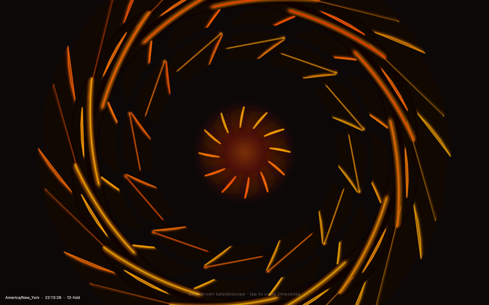
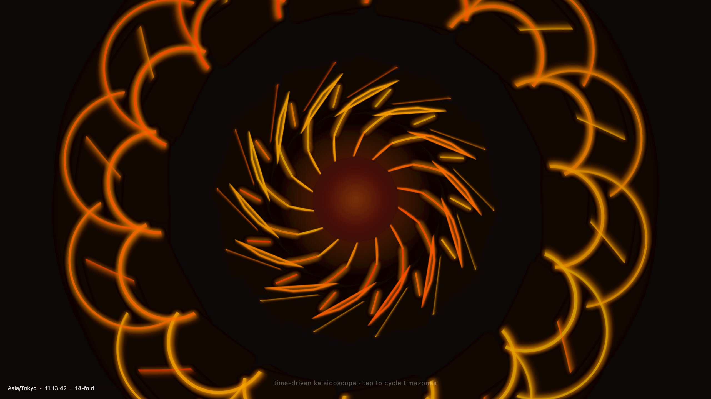

<div align="center">

<h1>tessellate</h1>

<p><b>A kaleidoscope set by the time of day.</b></p>

<p><i>The hour picks how many folds it has, the minute how fast it turns and how hot it glows. Tap to jump to another city's clock.</i></p>

<h6>


</h6>

<a href="https://parthchandak02.github.io/tessellate/"><b>Live demo</b></a> ·
<a href="#how-it-works"><b>How it works</b></a> ·
<a href="#run-it"><b>Run it</b></a>

<br><br>

<a href="https://parthchandak02.github.io/tessellate/"></a>

<sub>Live capture, 22 October 2026, New York time. Every load scatters new random seed shapes.</sub>

</div>

<br>

A one-day sketch from a "creative daily" series: a single `index.html`, Canvas 2D, no build
step and no dependencies. A handful of random seed shapes (arcs, lines with glowing end dots,
curves and small polygons) are drawn in one wedge and rotated round the centre, with a soft
trail so the motion leaves streaks. The current time in the selected time zone, fetched from
[timeapi.io](https://timeapi.io/), sets the symmetry and the mood.

## How it works

| Time field | Drives |
|---|---|
| Hour (on a 12-hour cycle) | Number of folds: an even count from 2 to 14 |
| Minute | Rotation speed, glow strength, brightness and the size of the centre glow |
| Second | A slow shift of each fold's colour through orange, red and amber |

Click or tap to step through twelve time zones: New York, London, Tokyo, Sydney, Cairo,
Auckland, Los Angeles, Dubai, Paris, Kolkata, São Paulo and Honolulu. The time is refetched
every 30 seconds and ticks locally in between. If timeapi.io can't be reached, the device clock
is converted into the selected zone, so the label still matches the time, and the corner text
says `device clock` instead of `timeapi.io`. Resizing the window rescales the seed shapes
rather than re-rolling them.

<div align="center">



<sub>Two taps later: Tokyo at 11 in the morning gives 14 folds. Live capture.</sub>

</div>

## Run it

```bash
git clone https://github.com/parthchandak02/tessellate.git
cd tessellate
python3 -m http.server 8000   # then open http://localhost:8000
```

Any static file server works; the live version is the same file on GitHub Pages. Palette,
trail length, seed count and the fold limit are in the `P` object at the top of the script.

<br>

<div align="center">
<sub>Built with plain HTML and Canvas 2D. Time from timeapi.io.</sub>
</div>
